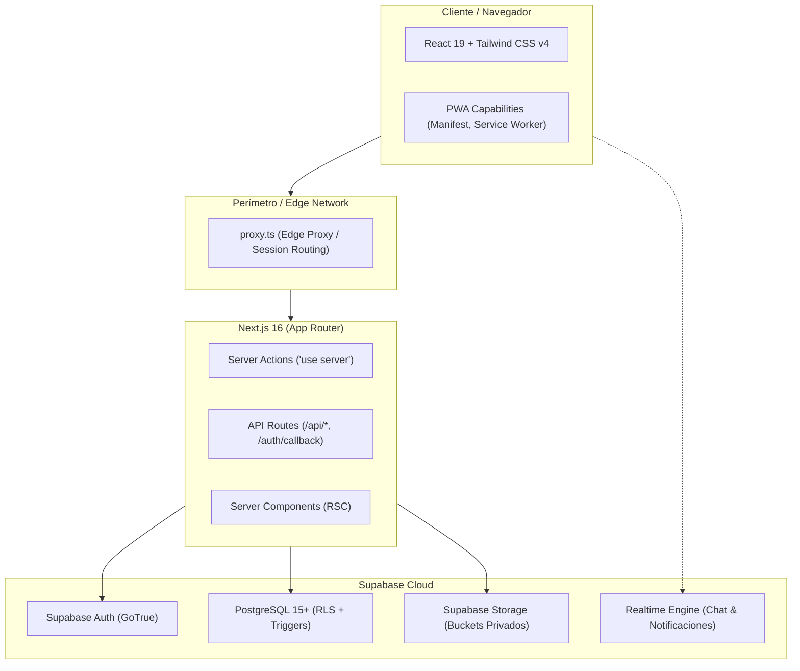
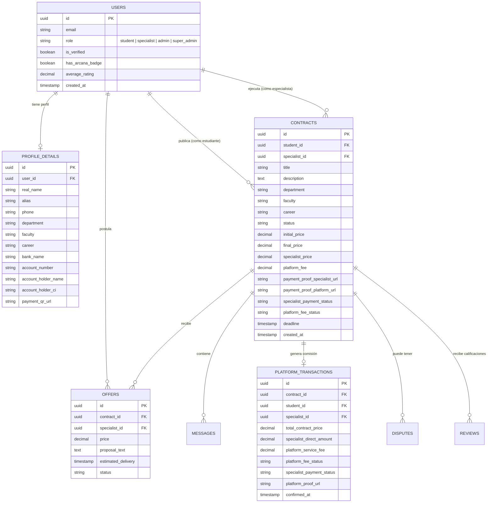
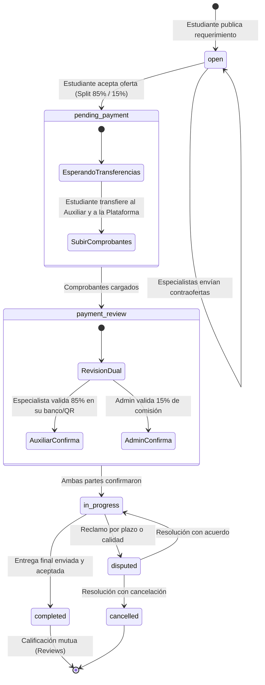

# Arquitectura Técnica — La Red Arcana

> **Estado**: Borrador Consolidado / Especificación de Arquitectura MVP  
> **Fecha**: Septiembre 2026  
> **Versión**: 2.0 (Post-Refactor P2P & Clean Architecture)  
> **Repositorio**: [La-Red-Arcana](https://github.com/reddington25/La-Red-Arcana)  

---

## 1. Visión General del Sistema

**La Red Arcana** es una plataforma web tipo marketplace académico diseñada para conectar a **estudiantes universitarios** que requieren apoyo en sus materias, proyectos o entregables con **especialistas y auxiliares de docencia verificados**.

### Principios Fundamentales de Diseño
1. **Modelo de Contraoferta (Estilo inDrive)**: El estudiante define su necesidad, plazo y un presupuesto inicial orientativo; los especialistas postulan con propuestas y tarifas personalizadas. El estudiante evalúa y selecciona según reputación, precio y carrera.
2. **Privacidad y Anonimato del Estudiante**: Para resguardar la privacidad académica de los usuarios, los estudiantes operan bajo un **alias público**, protegiendo su nombre real, correo institucional y número de teléfono.
3. **Validación Rigurosa de Especialistas**: Los auxiliares deben proveer documentación académica (carrera, facultad, estado académico, credencial universitaria/CI y CV) antes de ser verificados por los administradores.
4. **Desacoplamiento Financiero (Liquidación Directa P2P)**: Para evitar responsabilidades legales y tributarias de retención impositiva sobre los ingresos de los especialistas, la plataforma no custodia los honorarios del especialista, operando mediante pagos directos P2P combinados con una tarifa de servicio tecnológico de intermediación.

---

## 2. Diagramas Interactivos (Archify)

El repositorio incluye diagramas técnicos interactivos auto-contenidos generados con [Archify](https://github.com/tt-a1i/archify) que ofrecen vistas guiadas, trazado de rutas animadas y soporte de temas claro/oscuro:

* 📊 **[Arquitectura del Sistema (HTML Interactivo)](./la-red-arcana-architecture.html)**: Mapeo de clientes, Edge Proxy en Vercel, Server Actions en Next.js 16, persistencia y RLS en Supabase, y el desacoplamiento de cobro directo P2P (85%) y comisión técnica (15%). (Definición JSON: [`la-red-arcana-architecture.json`](./la-red-arcana-architecture.json)).
* 🔄 **[Ciclo de Vida del Contrato y Pagos P2P (HTML Interactivo)](./la-red-arcana-workflow.html)**: Diagrama de flujo operativo y contractual con carriles de responsabilidad (Estudiante, Especialista y Plataforma). (Definición JSON: [`la-red-arcana-workflow.json`](./la-red-arcana-workflow.json)).

---

## 3. Stack Tecnológico



| Capa | Tecnología | Justificación / Rol |
|---|---|---|
| **Framework Web** | Next.js 16.2 (App Router, Turbopack) | Server Components para renderizado optimizado, Server Actions para mutaciones seguras sin endpoints REST boilerplate. |
| **Biblioteca UI** | React 19 + Lucide React + Radix UI Toast | Componentes reactivos, iconos vectoriales y notificaciones accesibles. |
| **Estilos** | Tailwind CSS v4 + PostCSS | Estilizado utilitario de alto rendimiento con tema oscuro cyberpunk/arcano. |
| **Base de Datos** | Supabase (PostgreSQL 15+) | Relaciones relacionales estrictas, funciones PL/pgSQL, triggers y Row Level Security (RLS). |
| **Autenticación** | Supabase Auth (`@supabase/ssr`) | Manejo de sesiones persistentes vía cookies HTTP-only (`SameSite=Lax`, `Secure`). Soporte para Email/Password y Google OAuth. |
| **Almacenamiento** | Supabase Storage | Almacenamiento de archivos de requerimientos, CVs, fotos de credenciales, códigos QR y comprobantes de transferencia. |
| **Proxy / Middleware** | `proxy.ts` (Next.js Edge Proxy) | Intercepción de rutas protegidas y resolución de accesos según el rol del usuario en la sesión. |

---

## 3. Topología de Rutas y Estructura del Código

El proyecto utiliza la estructura de carpetas de **Next.js App Router**:

```
la_red_arcana01/
├── app/
│   ├── (admin)/admin/             # Portal Administrativo
│   │   ├── dashboard/             # Métricas globales y accesos rápidos
│   │   ├── escrow/                # Gestión de comisiones de plataforma
│   │   ├── verifications/         # Aprobación de auxiliares pendientes
│   │   ├── disputes/              # Resolución de controversias
│   │   ├── ambassadors/           # Auditoría del programa de referidos
│   │   └── security/              # Auditoría de accesos y registros críticos
│   ├── (specialist)/specialist/   # Portal del Auxiliar / Especialista
│   │   ├── dashboard/             # Trabajos activos, métricas y publicaciones
│   │   ├── opportunities/         # Feed de solicitudes filtrado por carrera/facultad
│   │   ├── contracts/[id]/        # Detalle de trabajo, chat y confirmación de cobro
│   │   └── profile/edit/          # Configuración académica y bancaria (QR)
│   ├── (student)/student/         # Portal del Estudiante
│   │   ├── dashboard/             # Solicitudes activas, historial y estados
│   │   ├── contracts/new/         # Formulario de publicación con jerarquía académica
│   │   ├── contracts/[id]/        # Gestión de ofertas, Hub de Pago Directo y entregables
│   │   └── profile/               # Gestión de alias y preferencias
│   ├── auth/                      # Flujos de Autenticación
│   │   ├── login/                 # Inicio de sesión / Creación de cuenta
│   │   ├── register/              # Selección de rol y perfil inicial
│   │   ├── callback/              # Intercambio de tokens OAuth (Google)
│   │   └── logout/                # Terminación de sesión segura
│   └── api/                       # Endpoints específicos de backend
├── components/                    # Componentes UI compartidos (chat, toast, layout)
├── lib/                           # Clientes Supabase (SSR/Browser), storage y constantes
├── types/                         # Tipado TypeScript estricto (database, reviews, disputes)
├── supabase/
│   ├── migrations/                # Migraciones DDL históricas y acumulativas
│   └── APLICAR_MIGRACIONES_EN_SUPABASE.sql # Script consolidado para base de datos
├── docs/                          # Documentación técnica, guías y modelos
├── scripts/                       # Herramientas de diagnóstico, SQL y PowerShell
└── proxy.ts                       # Interceptor perimetral de rutas por rol
```

---

## 4. Matriz de Roles y Control de Acceso

La plataforma define 4 roles con privilegios estrictamente delimitados:

| Rol | Alcance de Rutas | Privilegios Principales |
|---|---|---|
| **`student`** | `/student/*` | Crear requerimientos académicos, recibir contraofertas, chatear con postulantes, pagar directamente al auxiliar, subir comprobantes, recibir entregas y calificar. |
| **`specialist`** | `/specialist/*` | Explorar oportunidades afines a su facultad/carrera, enviar contraofertas, configurar datos bancarios y QR, chatear, subir borradores/entregables y confirmar pagos directos. |
| **`admin`** | `/admin/*` | Verificar y aprobar auxiliares, auditar comprobantes de comisión de plataforma, mediar disputas y supervisar actividad del sistema. |
| **`super_admin`** | `/admin/*` | Todos los permisos de `admin` más gestión de otros administradores y acceso a registros de auditoría de seguridad profunda. |

### Lógica de Enrutamiento en Perímetro (`proxy.ts`)
Para evitar bucles de redirección comunes en arquitecturas Next.js + Supabase SSR:
1. Si un usuario no autenticado solicita una ruta protegida (`/student/*`, `/specialist/*`, `/admin/*`), es redirigido a `/auth/login?redirectTo=<ruta>`.
2. Si un usuario autenticado intenta acceder al portal de otro rol (ej. un estudiante queriendo entrar a `/admin/*`), es redirigido automáticamente a la raíz `/`.
3. Si un usuario está registrado pero aún no ha completado sus detalles de perfil académico en `profile_details`, es derivado a `/auth/register` o `/auth/pending` según corresponda, impidiendo el uso de la plataforma en estado incompleto.

---

## 5. Modelo de Datos y Esquema Relacional



---

## 6. Seguridad en Base de Datos: Row Level Security (RLS) Anti-Recursión

En versiones tempranas del proyecto, consultar la tabla `users` dentro de las políticas RLS de la propia tabla `users` generaba **recursión infinita** en PostgreSQL.

### Solución Arquitectónica: Funciones `SECURITY DEFINER`
Se implementaron funciones SQL compiladas que ejecutan con permisos del propietario del esquema (`search_path = public`), consultando roles sin invocar recursivamente las políticas RLS de sesión:

```sql
CREATE OR REPLACE FUNCTION public.is_admin(user_id UUID)
RETURNS BOOLEAN AS $$
BEGIN
  IF user_id IS NULL THEN RETURN FALSE; END IF;
  RETURN EXISTS (
    SELECT 1 FROM public.users
    WHERE id = user_id AND role IN ('admin', 'super_admin')
  );
END;
$$ LANGUAGE plpgsql SECURITY DEFINER SET search_path = public;
```

### Principios de Aislamiento de Datos
1. **Contratos (`contracts`)**: Visibles únicamente para el estudiante creador, el especialista asignado, los administradores, o para especialistas verificados mientras el contrato esté en estado `open` y pertenezca a su facultad.
2. **Propuestas (`offers`)**: Un especialista solo puede ver y editar sus propias ofertas. El estudiante creador del requerimiento puede ver todas las ofertas recibidas en su contrato. Ningún especialista puede ver las ofertas de sus competidores.
3. **Mensajería (`messages`)**: Restringida con exclusividad al estudiante y especialista asignados al contrato activo, además de los administradores en caso de mediación.
4. **Privacidad de Perfiles (`profile_details`)**: Los datos sensibles de contacto (teléfono real, fotos de CI y CV) solo son visibles para el propietario y administradores; a terceros solo se expone el alias, carrera, insignias y reputación.

---

## 7. Ciclo de Vida del Contrato y Flujo de Pagos P2P



### Mecanismo de Activación Dual
Para que un contrato pase a estado `in_progress`:
1. El especialista confirma la recepción de sus honorarios directos (`specialist_payment_status = 'confirmed'`).
2. El administrador valida el comprobante de la comisión tecnológica (`platform_fee_status = 'confirmed'`).
3. El sistema activa automáticamente el estado del trabajo, notificando a ambas partes y habilitando el chat y la carga de borradores.

---

## 8. Almacenamiento de Archivos (Buckets de Storage)

| Bucket | Acceso | Propósito |
|---|---|---|
| `contract-files` | Privado | Archivos adjuntos de guías, enunciados y entregables de contratos. |
| `user-documents` | Privado | Fotos de Cédula de Identidad (CI) y CVs de especialistas para verificación de credenciales. |
| `payment-qrs` | Privado / Restringido | Imágenes de códigos QR bancarios de los especialistas. |
| `payment-proofs` | Privado | Capturas de transferencias bancarias y recibos de pago subidos por estudiantes. |

---

## 9. Próximos Pasos Técnicos para Escalar el MVP

1. **Notificaciones Push y WebSockets**: Reemplazar el sondeo periódico con canales de presencia y difusión en tiempo real (`Supabase Realtime`).
2. **Webhooks de Facturación Electrónica**: Conectar la confirmación de `platform_transactions` con un servicio de facturación tributaria local (facturación en línea para emitir factura fiscal automática por el 15% de comisión).
3. **Validación Automatizada de Pagos QR**: Integración futura con APIs de pasarelas locales (ej. Simple QR interoperable) para auto-verificar el fee de plataforma sin intervención manual del admin.
