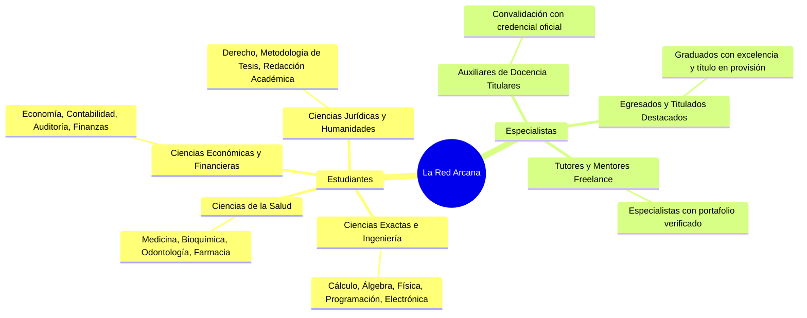

# Modelo de Negocio — La Red Arcana

> **Estado**: Borrador Estratégico / Modelo de Negocio MVP  
> **Fecha**: Septiembre 2026  
> **Versión**: 2.0 (Adaptado a Liquidación P2P y Exención de Retención Fiscal)  
> **Plataforma**: Red Arcana ([Marketplace Académico Universitario](https://github.com/reddington25/La-Red-Arcana))  

---

## 1. Resumen Ejecutivo y Propuesta de Valor

**La Red Arcana** es una plataforma tecnológica de servicios académicos que conecta a **estudiantes universitarios** con **auxiliares de docencia, egresados destacados y tutores especializados** de diversas carreras. 

La plataforma replica la agilidad de gigantes del trabajo independiente como *Workana*, *Upwork* o *Fiverr*, adaptada a la dinámica universitaria mediante un **mecanismo de contraoferta libre (tipo inDrive)** y una **política de estricta privacidad para el estudiante**.

```
                        ┌──────────────────────────────────────────────┐
                        │                LA RED ARCANA                 │
                        │           (Plataforma Tecnológica)           │
                        └──────┬────────────────────────────────┬──────┘
       Tarifa de Servicio (15%)│                                │Tarifa de Servicio (15%)
                               ▼                                ▼
                 ┌───────────────────────────┐    ┌───────────────────────────┐
                 │        ESTUDIANTE         │    │   AUXILIAR/ESPECIALISTA   │
                 │   (Demanda Académica)     │    │   (Oferta de Conocimiento)│
                 └─────────────┬─────────────┘    └─────────────▲─────────────┘
                               │                                │
                               └─────── Pago Directo P2P (85%) ─┘
                                   (Transferencia Bancaria / QR)
                                   (Sin retención fiscal de plataforma)
```

---

## 2. El Problema del Mercado

En el ecosistema universitario actual, los estudiantes recurren masivamente a canales informales (grupos de WhatsApp, Facebook, Telegram) en busca de ayuda con materias complejas, proyectos de laboratorio o preparación de exámenes. Este entorno presenta graves fricciones:

| Actor | Problemas Críticos Actuales |
|---|---|
| **Estudiantes** | • **Riesgo de estafa**: Pagos por adelantado a perfiles falsos que desaparecen sin entregar el trabajo.<br>• **Pésima calidad o plagio**: Proveedores no calificados sin conocimientos reales de la materia.<br>• **Riesgo de reputación/disciplinario**: Exposición de su nombre real o teléfono en grupos públicos. |
| **Auxiliares / Tutores** | • **Informalidad e impagos**: Estudiantes que reciben la ayuda o resolución y luego no transfieren el dinero acordado.<br>• **Pérdida de tiempo en captación**: Negociaciones interminables y regateo en chats individuales.<br>• **Incertidumbre tributaria**: Plataformas que les exigen emitir facturas complejas o les descuentan fuertes retenciones impositivas directas que reducen su margen. |

---

## 3. La Solución: Propuesta de Valor

### Para el Estudiante (Demanda)
- **Privacidad Total**: Opera con un **alias anónimo**; su nombre real no es visible para los postulantes.
- **Libertad de Negociación**: Define su presupuesto inicial y recibe múltiples contraofertas competitivas.
- **Filtro por Jerarquía Académica**: Encuentra especialistas específicos de su misma universidad, departamento, facultad y carrera.
- **Seguridad en la Transacción**: El trabajo sólo inicia cuando ambas partes acuerdan términos y se cuenta con un canal de mediación de disputas.

### Para el Auxiliar / Especialista (Oferta)
- **Monetización Justa y Directa**: Recibe el **85% de sus honorarios de forma directa e inmediata** en su cuenta bancaria o QR.
- **Cero Retención de Impuestos por la Plataforma**: No sufre descuentos impositivos sobre sus ingresos brutos por parte de la plataforma.
- **Construcción de Reputación**: Insignias de confianza (*Arcana Badge*, *Excellence Badge*) y calificaciones verificadas que le permiten cobrar mejores tarifas con el tiempo.
- **Concentración de Oportunidades**: Acceso a un panel centralizado de requerimientos organizados por carrera.

---

## 4. Segmentos de Clientes



---

## 5. Dinámica de Mercado: El Modelo de Contraoferta (Estilo inDrive)

En lugar de precios fijos artificiales o tarifas rígidas impuestas por la plataforma, La Red Arcana implementa una **subasta inversa con negociación dinámica**:

1. **Publicación del Requerimiento**: El estudiante publica el título, descripción, documentos adjuntos, fecha límite estricta y un **precio de referencia inicial**.
2. **Postulación con Contraoferta**: Los especialistas ven la oportunidad y pueden:
   - Aceptar el precio del estudiante.
   - Enviar una contraoferta con un precio superior o inferior fundamentado en la complejidad y plazo.
3. **Evaluación de Factores**: El estudiante compara las propuestas ponderando:
   - Tarifa propuesta.
   - Puntuación promedio (estrellas) y número de trabajos completados.
   - Insignias de excelencia y carrera afín.
4. **Cierre de Trato**: Al aceptar una oferta, el precio queda formalizado y se calculan las partes correspondientes (85% para el especialista, 15% para la plataforma).

---

## 6. Arquitectura Financiera: Solución al Dilema Impositivo

### 6.1 El Fracaso del Modelo Escrow Tradicional
En el diseño inicial del proyecto, se planteó un sistema de custodia (Escrow):
```
[Estudiante] ──(100% de los fondos)──> [Cuenta Bancaria de la Plataforma]
                                                    │
                                           (Custodia Temporal)
                                                    │
                                                    ▼
[Auxiliar] <──(85% al completar)────── [Plataforma libera fondos]
```

#### ¿Por qué este modelo colapsaba a nivel legal y tributario?
1. **Facturación Forzada del 100%**: Al ingresar la totalidad del dinero a la cuenta bancaria de la empresa, el fisco/impuestos asume que la plataforma facturó la totalidad del servicio.
2. **Agente de Retención Impositiva**: Para desembolsar el 85% a los auxiliares (quienes en su mayoría son estudiantes universitarios sin registro tributario, NIT o monotributo), la legislación tributaria exige que la plataforma les retenga impuestos de servicios de terceros (IUE, IT, IRPF o similares), reteniendo entre un 13% y un 16% adicional de su ganancia.
3. **Rechazo de los Auxiliares**: Los especialistas se negaban a participar si se les exigía factura personal o si la plataforma les recortaba impuestos directamente.

---

### 6.2 El Nuevo Modelo: Pagos P2P + Tarifa Tecnológica de Conexión
Para blindar el negocio legal y fiscalmente, La Red Arcana adoptó un **modelo de desintermediación de custodia**:

```
                              [Estudiante]
                                   │
                 ┌─────────────────┴─────────────────┐
                 │ (85% Honorarios)                  │ (15% Comisión)
                 ▼                                   ▼
      [Cuenta Bancaria / QR]              [Cuenta Oficial Plataforma]
      (Directo al Auxiliar)               (Ingreso Propio por Servicio)
                 │                                   │
                 │                                   ▼
        [CERO Retención]                   [Emisión de Factura Fiscal]
    (No pasa por la empresa)              (Únicamente por el 15% de fee)
```

#### Beneficios Clave del Modelo:
- **Exención de Retenciones a Auxiliares**: La plataforma nunca recibe los honorarios del auxiliar, por lo que jurídicamente **no es su empleador ni agente de retención**.
- **Facturación Transparente**: La plataforma factura única y exclusivamente el 15% de comisión por el uso del software y la intermediación tecnológica.
- **Flujo de Caja Inmediato**: No existen saldos bloqueados en pasivos de custodia ni requerimientos de licencias bancarias o fintech para custodia de fondos de terceros.

---

## 7. Estructura de Ingresos (Vías de Monetización)

### 7.1 Monetización del MVP (Actual)
- **Tarifa de Servicio Tecnológico (15% por Contrato)**: Cobrada al estudiante al momento de confirmar el contrato. Se genera un registro contable en `platform_transactions`.

### 7.2 Vías de Monetización en Fase de Escalamiento
1. **Suscripción de Especialistas ("Arcana Pro")**:
   - Acceso prioritario para postular a solicitudes 30 minutos antes que los usuarios regulares.
   - Comisión reducida del 10% en lugar del 15%.
   - Insignia de perfil destacado (*Arcana Pro Badge*).
2. **Tarifa por Entrega Express / Urgencia**:
   - Tarifa fija adicional de intermediación para solicitudes con plazos inferiores a 24 horas.
3. **Paquetes de Créditos para Estudiantes**:
   - Posibilidad de prepagar paquetes con descuento para cubrir comisiones recurrentes del semestre.
4. **Alianzas Universitarias / Tutorías Corporativas**:
   - Venta de acceso a la red de mejores egresados para academias preuniversitarias o institutos de nivelación.

---

## 8. Estructura de Costos y Unit Economics

```
INGRESOS BRUTOS: 15% del valor de cada contrato académico

COSTOS VARIABLES POR CONTRATO:
├── Costo de pasarela / procesamiento de pago del fee: ~2% - 3%
├── Soporte y validación manual (MVP): ~2%
└── Carga tributaria (Impuestos sobre el 15% facturado): ~2% - 3%

MARGEN DE CONTRIBUCIÓN ESTIMADO: ~50% - 60% del fee generado
```

### Costos Fijos de Operación
- **Infraestructura Cloud**: Hosting en Vercel Pro + Supabase Pro Tier (~$45 - $60 USD/mes base).
- **Dominio y Seguridad**: Certificados SSL, dominio corporativo y backups automatizados.
- **Equipo de Validación**: Personal administrativo encargado de auditar títulos y credenciales de auxiliares.

---

## 9. Estrategia Go-To-Market (GTM) y Adquisición

```mermaid
flowchart LR
    subgraph Adquisición Oferta["1. Oferta (Auxiliares)"]
        A1["Contacto directo con mejores promedios y centros de estudiantes"]
        A2["Programa de Embajadores (Referidos con código)"]
    end

    subgraph Adquisición Demanda["2. Demanda (Estudiantes)"]
        D1["Campañas en épocas de exámenes parciales y finales"]
        D2["Grupos universitarios por facultad (Telegram / WhatsApp)"]
    end

    subgraph Retención["3. Retención y Red"]
        R1["Sistema de Insignias y Calificaciones"]
        R2["Garantía de privacidad con Alias"]
    end

    Adquisición Oferta --> Retención
    Adquisición Demanda --> Retención
```

### 1. Fase Semilla (Carreras de Alta Demanda):
Iniciar con facultades de alta densidad de trabajos complejos y cuantificables:
- **Ingeniería**: Cálculo, Física, Álgebra Lineal, Programación.
- **Ciencias Económicas**: Contabilidad, Finanzas, Estadística.
- **Medicina / Bioquímica**: Fisiología, Anatomía, Química Orgánica.

### 2. Programa de Embajadores Universitarios:
- Especialistas o estudiantes destacados actúan como embajadores de su facultad.
- Reciben una fracción de la comisión de plataforma por cada usuario activo que se registre con su código promocional (`ambassador_code`).

---

## 10. Matriz de Riesgos y Estrategias de Mitigación

| Riesgo Identificado | Nivel | Estrategia de Mitigación |
|---|---|---|
| **Desintermediación (Contacto por fuera)** | Alto | • **Ocultamiento de datos de contacto**: El chat interno bloquea el intercambio de números o correos hasta que se acepta la oferta.<br>• **Incentivo de reputación**: Solo los contratos realizados dentro de la plataforma suman estrellas, reseñas y visibilidad.<br>• **Garantía de mediación**: Si pagan por fuera y son estafados, no tienen soporte. |
| **Comprobantes de Pago Falsos** | Medio | • **Mecanismo de Doble Confirmación**: El contrato no avanza a `in_progress` hasta que el auxiliar confirma haber recibido sus fondos en su app bancaria personal y el admin valida el fee. |
| **Problemas de Calidad o Plagios** | Medio | • **Proceso de Verificación**: Validación obligatoria de CI y respaldo académico antes de habilitar a un auxiliar.<br>• **Sistema de Disputas**: Posibilidad de abrir reclamo en el contrato para mediación por el administrador.<br>• **Degradación de Perfil**: Calificaciones negativas reducen drásticamente la visibilidad del auxiliar. |
| **Riesgo Regulatorio / Tributario** | Bajo (Mitigado) | • Resuelto mediante el **modelo P2P**: la plataforma no retiene honorarios de auxiliares y solo factura su tarifa de intermediación de software. |

---

## 11. Conclusión

El modelo de negocio de **La Red Arcana** resuelve una necesidad latente en el entorno universitario, formalizando un mercado que hoy opera en la clandestinidad y la desconfianza. Al eliminar la custodia financiera y transformarla en una relación P2P con tarifa de software, la plataforma alcanza **viabilidad legal inmediata, bajos costos de fricción y escalabilidad operativa**.
